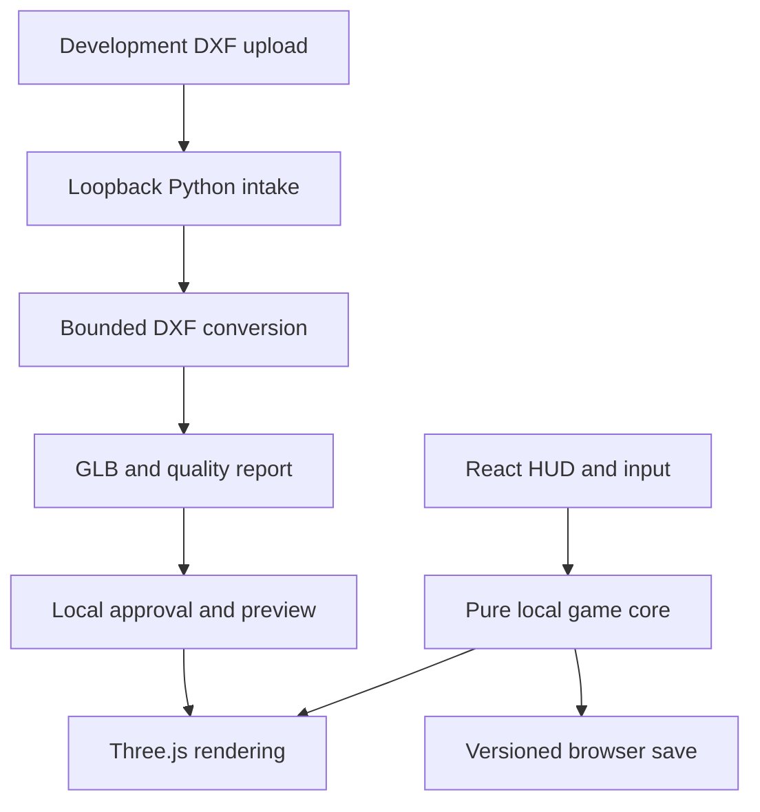

# Architecture and decisions

## Product baseline

A character-driven survival action RPG with ships, beasts, persistent river
colonies, resource logistics, and granite pyramids with gold apexes. Colony
simulation supports the inhabited world. It is not a city-planning-only game.
The accepted v1.0 requires playable maritime gameplay AND an operable handoff.

## Contribution projection (0.9)

Shared-room standings rebuild from retained authoritative delivery events with
room/actor/sequence fact identities. No additional writable score aggregate or
cross-room transaction is introduced. Catalog-checked facts aggregate players,
fixed professions and receiving colonies with deterministic tied ranks. Every
view declares preview eligibility; official regional seasons remain a separate
identity/governance/archival boundary. See CONTRIBUTIONS.md.

## Colony economy extension (0.8)

COLONY_ECONOMY.md describes finite recipe batches, population labor, shipment
contract phases and one-time benefits. Colony stock release joins the existing
room/custody transaction. Shared production replaces scripted stock increments;
private/offline behavior is unchanged. Versioned economy data upgrades in place.

## Shared authority extension (0.7)

SHARED_WORLD.md describes one room transaction over common state and owned
characters, consent-based cross-player custody, room-wide demand/capacity, helm
leases and crew reference frames. Public projections render other players and
owned structures without disclosing private inventories. Private mode remains
separate. Both modes are verified locally, not deployed/scale-certified.

## Private authority extension (0.6)

AUTHORITY.md documents signed actor/room access, a private expedition aggregate,
transactional command sequencing and browser reconnect. Online clients use server
snapshots instead of the local transition loop. The same named room still isolates
players; shared-world and shared-crew semantics remain pending. Legacy APIs remain
staging-only and separate from the new namespace.

## Ferry extension (0.5)

FERRY.md describes the independent vessel pose, deck-local passenger frame,
offshore geometry, helm controls and separate cargo endpoint. The boat remains
kinematic and single-player. The existing skiff and river economy remain intact.

## Implemented boundaries

Movement runs in the frame loop without publishing per-frame React state.
The scene samples visual state at 5Hz; the HUD samples on commands and 1Hz ticks.
The local core still clones state per movement step: sufficient for this tiny
slice, not a scalability claim. Render transforms are transient refs.

Time advances only while the application is running. No offline catch-up,
deterministic fixed-step lockstep, wind propulsion,
network prediction or hydrodynamic simulation is implemented. Sailing is planar
kinematic motion. River topology is a fixed corridor and open sea boundary.

Offline/private colonies retain scripted 10-tick stock changes. Shared rooms now
use finite recipe/reserve batches and a population labor budget; contract and relic
completion grant recorded population changes. There is no individual NPC scheduler,
pathfinding, famine/death model, trade market or autonomous expansion. Water field is a downstream count along
one linear river, displayed as a regional water tint. It does not simulate
chemistry, branching tributaries, flooding, or rainfall.

## Runtime boundaries and remaining services

- Signed-room gateway and shared/private authority are implemented locally; public
  identity onboarding and asset authorization remain unfinished.
- Room Durable Object accepts commands and owns common state, character custody
  and the bounded colony economy; deployment/capacity are unverified.
- D1 records player/checkpoint metadata with revision and migration strategy.
- R2 separates quarantine, review outputs, and immutable published assets.
- Python Worker coordinates job metadata through a queue.
- Sandboxed external compute performs DXF/Blender work with bounded resources.
- Authorized review promotes manifests; clients fetch immutable GLBs.

Blender is not embedded inside a Python Worker. Native processing remains an
external runtime. Do not treat the provided queue producer as a complete pipeline.

## Decisions

1. Keep modules in one repository; no unnecessary Git submodule topology.
2. Root Make targets wrap native toolchains. npm lockfile fixes JS resolution;
   Python dependencies are version-pinned. No claim of bit-identical OS builds.
3. Preserve raw CAD bytes; limited convex profiles first, strict rejection of
   unsupported geometry. Never silently discard DXF entities.
4. GLB is a runtime delivery format; DXF is a design/import source.
5. Existing cloud save format remains separate from the new game snapshot.
6. Disable ungated persistent API use rather than ship a fake login flow.
7. Use pre-1.0 slice versions for verified progress; v1.0 requires all handoff gates.

## Trust boundaries

Local storage and the local client are untrusted for competitive outcomes.
Never replay client snapshots directly into an authoritative economy.
The loopback intake is a developer tool, not a hardened multi-user service.
A future gateway must verify actual stream size, source hash, owner, profile,
rate limits, immutable object keys, and acceptance before job submission.
See CONTRACTS.md and HANDOFF.md for remaining integration responsibilities.
