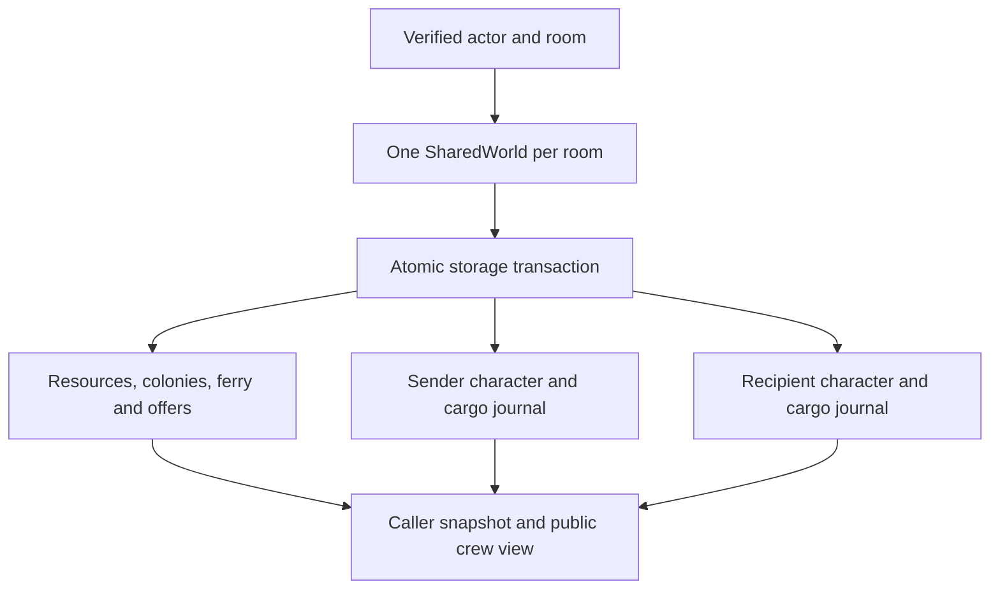

# Shared colony authority — 0.7.0

Shared colony rooms now run through one authoritative Durable Object per room.
They share finite nodes and salvage, colony construction/stocks, beast state,
expedition completion and one 160 m ferry. Characters retain inventories,
equipment, skiffs, attachments, owned structures and custody journals. The browser
renders other active characters and their placed structures from public projections.

The original `/api/authority/:room/...` private expedition path is preserved.
The new `/api/world/:room/{snapshot,command}` path uses `SHARED_WORLDS`, exported
class `SharedWorld`, and migration `v3-shared-world`. Existing private progress is
neither imported nor overwritten. The same manually issued actor/room credential
can enter either mode, but the resulting expeditions and browser outboxes are
separate. Select “Shared colony room” in “Online expeditions · preview”.

## Ownership and transaction boundary

Storage contains one `world` value and `player:<actor>` values. A character
record excludes common fields; its game state is composed from current common
state on every command and read. The domain's `local-player` item/lot owner is
scoped by that actor's record, not treated as a global user identifier. Public
placement identity is `(actor, instanceId)`. A caller cannot equip, pack, move or
withdraw an instance in another character's record by guessing its local ID.

Each actor retains an independent monotonically increasing command sequence and
latest receipt. Commands from different actors do not need to fight over a global
expected sequence. The transaction decides against the latest common resources
and constraints. Competing gathers cannot duplicate the last unit; competing
construction cannot spend the same supplies or overlap another owner's structure.
An identical latest retry returns the current projection without applying again,
even if another player has changed the room since the original acknowledgement.
Older or changed retries conflict. No automatic economic rebase is performed.

Every composed character passes the core restore/invariant checks before writes.
All capacity checks precede persistence. Sender, recipient, offer, common state
and caller receipt commit together. A failed non-caller write rolls back the
transaction. Unchanged character values are not rewritten. Cargo has domain events;
movement/common state use snapshots rather than appending per-frame economy events.
This is hybrid persistence, not a complete event store for the entire world.

The room projection exposes active actor IDs, professions, modes and positions,
placed-object definitions/positions, aggregate demand/freight totals and helm
ownership. It does not expose other inventories, equipment lists or custody
journals. Offers are visible only to sender and recipient. Inactive structures
remain visible and collidable; inactive avatars disappear after 45 seconds.
Character-to-character collision and skiff-to-skiff collision are not implemented.
Foreign workstations/crates remain owner-operated; cooperative workshop access
and paid trading are separate future features.

## Shared ferry and time

Each passenger stores a deck-local attachment; world position is derived from the
single ferry pose. Boarding, walking, helm proximity, gangway handling and safe
exits reuse the tested core. All skiffs are checked conservatively when advancing
the ferry hull. Foreign placed structures also block foot movement and landings.

A transaction can grant only one helm lease. Only the holder's input changes
throttle/turn or sails. Accepted holder commands renew the lease for five seconds;
held input expires after 350 ms. Another passenger cannot release or seize an
active lease. Once the holder stops sending accepted commands, a subsequent room
command expires the lease, clears control and furls sails. Other crew can then
acquire the helm. A late reconnect projects the former holder as a deck passenger.
Explicit release relinquishes control immediately while allowing ordinary coasting.

The room clock advances once from shared server time, capped at 100 ms per
accepted request, independently of personal movement clocks. Two players sending
at the same wall-clock instant cannot double the simulation rate. Idle time is
discarded; no room alarms, background simulation, offline rewards or catch-up
motion is implemented. Lease expiry is enforced when a room is next active, not
by a background alarm. Reads project an expired helm as vacant without granting
control. Shared beast cooldown and colony production tick once; nearby skiffs
receive the common encounter's tick damage.

## Consent-based cargo custody

Unload a lot at Haven/Aurum warehouse or the stopped ferry gangway. In the crew
panel, choose a lot, quantity and active recipient. Both characters must have a
profession and be beside that common custodian. The offer shows good, quantity,
condition, custodian and any consignment obligation before acceptance.

- `cargo-offer` reserves the entire source lot against handling while the offer
  is pending, even when only a partial quantity is offered. No custody changes yet.
- `cargo-accept` is valid only for the named recipient. It rechecks physical
  proximity and stopped-vessel access, then removes the offered quantity from the
  sender and appends it to the recipient in the same storage transaction.
- Either participant can `cargo-cancel`. Offers expire after two minutes. One
  outgoing offer per sender and at most 16 pending offers are permitted.

Acceptance appends `CargoReleased` and `CargoAccepted` events to the respective
journals, plus a room handoff record linking actor/lot identities. The recipient
gets a local lot ID and an immutable provenance reference to the original actor,
root lot and room. Further handoffs preserve that original reference. Quantity,
condition, origin, shipped flag and consignment survive transfer. Receiving a
worn component does not repair it. Receiving into an overflowing journal/lot set
fails without changing custody. The recipient's command sequence changes only
when they submit a command; an incoming transfer can advance their cargo revision.
A stale cargo form therefore rejects rather than silently rebasing.

Warehouses share their 128-unit capacity across all owners; the ferry shares
96 units. Private skiffs/crates retain their own capacities. A transfer of ownership
at one custodian does not create capacity. Reservations plus completed quantities
for each work order are bounded across the entire room. A consigned handoff
preserves the reservation; the captain who completes delivery gets the local
contribution credit and the common colony receives supplies once. These are not
yet official seasonal/regional leaderboard points or monetary entitlements.

## Bounded preview and operations

Eight persistent characters may be admitted to a room. This is an admission guard,
not an eight-player load/cost certification. Departing characters are retained;
there is no automatic eviction/reset that replenishes resources. Account/room
provisioning, moderation and retention need operational policy.

Actual request bodies are capped at 8 KiB; signatures, room scope, origin checks,
75 ms per-actor command pacing and client retry/conflict rules follow AUTHORITY.md.
Both each stored character value and the common world value are capped at
120,000 serialized bytes. Cargo journals retain the 512-event limit; the room
handoff journal also stops at 512 entries. Capacity exhaustion fails closed rather
than dropping provenance or receipts. Archival/checkpoint migration and recovery
operator tools remain unfinished. Frequent snapshot writes, all-member reads and
10 Hz unpredicted clients need measurement and optimization before public scale.

Infrastructure must review the new binding/migration in its environment config,
install the signing secret, configure the exact browser origin and issue scoped
credentials. Use separate staging resources and the existing guarded Make deploy
target. No cloud resource or remote migration was applied in this session.
`make test-authority` runs both private and two-client shared checks with actual
local workerd/SQLite. See VALIDATION_0.7.md for evidence and acceptance limits.
